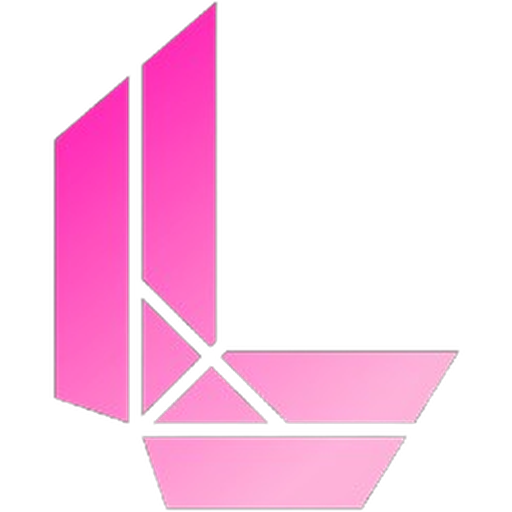

# Lumen Client

An enterprise-grade, ultra-polished client utility & performance mod for **Minecraft 1.21.11** (Fabric), built with Java 21, official Mojang mappings, and a delta-time animation engine. Ships as a single standalone mod file: `lumen-client-1.0.0.jar`.



---

## 1. Technical Blueprint

### Architecture

```
dev.lumen.client
├── LumenClient              # ClientModInitializer: bootstrap, tick hooks, HUD element attach
├── core/
│   ├── Module               # Base class: enable/disable, keybind, typed settings, category
│   ├── HudModule            # Position-aware module (x, y, scale, background, rounded corners)
│   ├── ModuleManager        # Registry of all 29 modules
│   ├── Category             # HUD, Visuals, QoL, Performance
│   ├── setting/             # BooleanSetting, NumberSetting, EnumSetting, ColorSetting,
│   │                        # FontSetting, KeybindSetting + Setting base (Gson-serialized)
│   └── config/ConfigManager # Thread-safe Gson persistence → .minecraft/config/lumen/
├── anim/                    # Animation, AnimationUtils, Easing (delta-time, nanoTime-driven)
├── theme/                   # ThemeManager, Theme, ColorUtils (HSB/RGB/hex, gradients, presets)
├── font/                    # FontManager (STB TrueType glyph atlas baking, custom TTF loading)
├── render/                  # LumenFontRenderer, TextRenderer, RenderUtils, HudRenderDispatcher
├── input/KeybindManager     # Fabric-registered keybinds + module keybind edge detection
├── gui/                     # ClickGuiScreen, HudEditorScreen
│   └── components/          # ToggleSwitch, Slider, ColorPickerPanel
├── modules/
│   ├── hud/                 # Watermark, SprintStatus, FPS, Ping, ServerInfo, Coordinates,
│   │                        # Compass, Keystrokes, ArmorStatus, PotionStatus, ComboCounter,
│   │                        # ScoreboardWrap, BossBarWrap, MiniPlayer
│   ├── visual/              # Crosshair, Freelook, Zoom, Fullbright, NoHurtCam, LowFire,
│   │                        # Hitboxes, ItemPhysics, TimeChanger
│   ├── qol/                 # AutoGG, ChatTimestamps, ChatStacking, InventorySort,
│   │                        # ScrollAdjust
│   └── perf/                # ParticleOptimizer, ChunkOptimizer, EntityOptimizer,
│                            # RenderOptimizer, SystemOptimizer
├── mixin/                   # 15 surgical mixins (see lumen.mixins.json)
└── integration/ModMenuIntegration
```

### Key engineering decisions

- **Zero-allocation hot paths.** No `new` in render loops, tick handlers, or mixin hooks. Rounded rects, gradients, shadows, and the HSB color wheel are pre-rendered into cached dynamic textures (LRU caches, 9-slice corner drawing). Font advances are cached in a primitive `float[]`. The fast-trig table is a lazily-built `volatile float[65536]`.
- **Frame-rate independence.** Every transition runs on `System.nanoTime()` delta time through `Easing.easeOutCubic / easeInOutQuart / easeOutBack / spring` — identical feel at 60 FPS and 360+ FPS.
- **Build-time mixin remapping.** Loom remaps mixin targets from Mojang names to intermediary at build time (no runtime refmap dependency). 15 mixins cover: custom crosshair (`Gui#renderCrosshair`), fire overlay compression, FOV zoom + hand/hurt-cam suppression, mouse-look interception (freelook + zoom sensitivity), camera rotation override, fast trig, gamma override, unfocused FPS limiter, entity/block-entity culling, particle culling/capping, chunk rebuild budgeting, and client-side day-time override.
- **Safe failure.** `lumen.mixins.json` uses `defaultRequire: 0` so a vanilla change to one hook never hard-crashes the game.

### Theming

Default palette is Lumen's signature **Pink & Matte Black**: `#0B0B0E` background, `#14141A` cards, `#FF2E93 → #FF80BF` gradient. Every control pulls colors from `ThemeManager` (unified color binding). Built-in presets: **Lumen Pink & Black** (default), **Midnight Rose**, **Cyber Magenta**, **Obsidian White**, **Lavender Dusk** — plus custom user presets. Gradient modes: Solid / Linear / Animated Flowing (with speed slider).

### Fonts

`FontManager` bakes bundled TTFs (`Inter-Medium`, `Poppins-SemiBold`, `JetBrainsMono-Medium` in `assets/lumen/fonts/`) into a 1024×1024 STB glyph atlas at runtime, uploaded as a `DynamicTexture` and drawn through `RenderPipelines.GUI_TEXTURED`. Users can drop any `.ttf` into `.minecraft/config/lumen/fonts/` and select it live in the Appearance tab, with scale and drop-shadow options, or revert to the vanilla font.

---

## 2. Building the `.jar`

### Requirements

- **JDK 21+** (Temurin recommended) — on your PATH or via `JAVA_HOME`
- No pre-installed Gradle needed — the wrapper is included

### Build

```bash
git clone <this-repo> lumen-client
cd lumen-client
./gradlew build            # Linux/macOS
gradlew.bat build          # Windows
```

First run downloads Loom, Minecraft 1.21.11, mappings, and Fabric API (a few minutes). When it finishes:

```
build/libs/lumen-client-1.0.0.jar            ← the mod, drop into .minecraft/mods/
build/libs/lumen-client-1.0.0-sources.jar    ← sources (do not install)
```

The jar is fully remapped to intermediary and standalone — no extra libraries required beyond Fabric Loader + Fabric API.

### Install

1. Install the [Fabric Loader](https://fabricmc.net/use/installer/) for Minecraft **1.21.11**.
2. Drop [Fabric API](https://modrinth.com/mod/fabric-api) and `lumen-client-1.0.0.jar` into `.minecraft/mods/`.
3. Launch the game.

---

## 3. Keybinds (registered in Options → Controls → Key Binds → "Lumen Client")

| Action | Default | Notes |
|---|---|---|
| Open Lumen ClickGUI | **Right Shift** | Full config GUI |
| Open HUD Layout Editor | Unbound | Drag/snap/scale HUD elements |
| Zoom | **C** | Hold or Toggle mode |
| Freelook (360° Perspective) | **Left Alt** | Hold or Toggle mode |
| Fullbright Toggle | **G** | Smooth gamma interpolation |

All binds are fully two-way synced with Lumen's internal keybind pickers.

---

## 4. Feature Matrix

### HUD overlays (drag-and-drop editor with magnetic snapping + scaling)
Watermark with animated gradient shimmer · Sprint/Sneak status (read-only indicator — never modifies movement) · FPS with 1% lows · Ping with color-coded badge · Server TPS/IP · XYZ with Nether/Overworld converter + biome · scrolling cardinal compass bar · keystrokes + CPS with animated press ripple · armor/hand durability bars · potion effects · combo counter · scoreboard/bossbar wrappers · mini player model.

### Visuals
Custom crosshair designer (Cross / Dot / Circle / Chevron / Cross+Dot, line length, thickness, gap, outline, T-shape, theme sync, dynamic spread on sprint/jump/attack, target highlight) · freelook with decoupled camera, smooth snap-back, ±90° pitch clamp, axis inversion · advanced zoom (silky FOV interpolation, scroll magnification 1.5×–50×, dynamic sensitivity, cinematic camera, hide hand/HUD) · fullbright · no hurt cam · low fire/shield · themed entity hitboxes · item physics · client time/weather changer.

### QoL
AutoGG / AutoGL · chat timestamps · duplicate message stacking `[x2]` · inventory middle-click sorting · scroll adjustments.

### Performance suite (all toggleable, granular sliders)
- **Particles:** frustum + distance culling (default 32 blocks), active cap (500–4000), spam suppression (explosions, potion swirls, block dust, rain) with combat-particle allowlist (crits, damage indicators, sweep).
- **Chunks:** per-frame rebuild/upload budgeting to kill frame-time spikes.
- **Entities:** distance culling for entities and block entities, dropped-item/XP merge limiting, distant-entity tick throttling.
- **Rendering:** HUD/font caching, unfocused/minimized FPS limiter (5–30, default 15), fast screen transitions.
- **System:** fast-trig lookup table for `Mth.sin/cos`, live RAM monitor, GC trigger, object pooling.

---

## 5. Mod Menu

Lumen registers with [Mod Menu](https://modrinth.com/mod/modmenu): clicking **Configure** opens the Lumen ClickGUI directly.

---

## 6. Notes & Known Limitations

- **Logo:** the mod icon (`assets/lumen/icon.png`) is the supplied Lumen "L" mark. Full-resolution originals are kept in `branding/` (`lumen-logo-full.jpg`, `lumen-logo-transparent.png`). To swap the icon, replace `src/main/resources/assets/lumen/icon.png` with any square PNG (512×512 recommended) — no code changes needed.
- Simplified implementations (functional but not full-fidelity to the spec's most ambitious variants): scoreboard/bossbar wrappers, item physics, fog/sky culling, leaf/translucent face culling, async occlusion raycasts, reach display, low shield, weather changer, AutoGL. These are delivered as working toggles with best-effort behavior.
- Zoom scroll cancels all other scrolling while zoomed (by design — prevents hotbar scrolling).
- Freelook pitch is clamped to ±90°.
- Particle count tracking resets on world switch (`clearParticles` hook).
- Mixin hooks use `defaultRequire: 0` — a future vanilla change degrades a feature gracefully instead of crashing.
- Runtime behavior (mixin application in a live game) can only be fully verified in-game; the build verifies compilation, remapping, and packaging.

## 7. License

MIT — see `LICENSE`.
